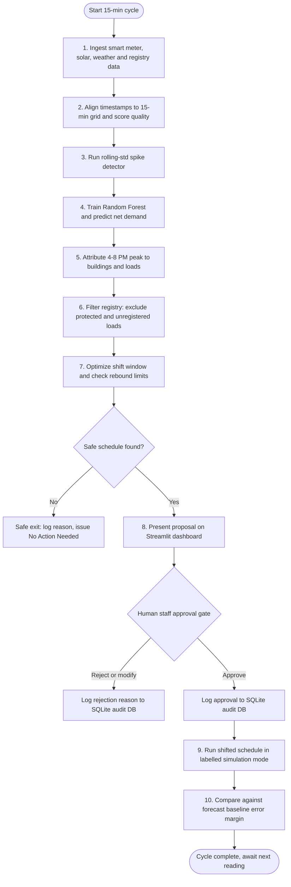

# PeakShift-AI ⚡

> **Intelligent Load Scheduling and Demand Response for Campus Energy Management**
> *A Problem-First Approach to "The 4 PM Spike"*
> **AI Synergy Hackathon 2026 · Case 05 · Track: AI for Energy & Environment**

[](https://www.python.org/)
[](https://streamlit.io/)
[](https://fastapi.tiangolo.com/)
[](https://www.sqlite.org/)
[](https://scikit-learn.org/)
[](https://peakshift-ai-hglx973qwfmu5tka5wyvpd.streamlit.app/)

> 🚀 **Live Demo:** [Open the PeakShift-AI simulator](https://peakshift-ai-hglx973qwfmu5tka5wyvpd.streamlit.app/)
> *Runs on synthetic data in simulation mode. If the app shows a "wake up" screen, click the button and wait a few seconds.*

---

## 📌 Executive Summary

**PeakShift-AI** is a software-only campus energy advisory and demand-response system designed to flatten the weekday **4:00 PM – 8:00 PM net grid peak ("The 4 PM Spike")**.

Instead of acting as an uninspectable "black-box" control model, PeakShift-AI helps campus facilities engineers answer three operational questions *before* any optimization takes place:

1. **Which loads drive the peak?** Attribution across uneven metering (15-minute smart meters and monthly aggregates).
2. **Which of them can safely move?** Staff-confirmed flexibility windows with strict safety hard-locks.
3. **Did our intervention actually work?** Counterfactual verification against forecast error bounds.

---

## 🚦 Round 1 Status and Prototype Scope

- **Status:** Round 1: Problem Discovery, Technical Feasibility Proof and Working Prototype.
- **Data resolution:** All datasets use a **15-minute grid (96 slots/day)** across 120 synthetic evaluation days.
- **Safety boundary:** Version 1 provides **zero direct physical control** of campus electrical infrastructure. Every proposed schedule is labelled **SIMULATION** and is blocked until an authorized engineer logs approval in the audit trail.
- **Critical protection:** Laboratory equipment, server rooms and student-welfare loads are hard-locked (`PROTECTED`) and never shifted.

---

## 📄 Table of Contents

1. [Problem Discovery and Framing](#section-1)
2. [Evidence Map](#section-2)
3. [End-to-End System Workflow](#section-3)
4. [Technical System Architecture](#section-4)
5. [Streamlit UI Wireframe](#section-5)
6. [Core Algorithm Pseudocode](#section-6)
7. [Dataset Exploration and Data Schemas](#section-7)
8. [Repository Structure](#section-8)
9. [API Specification](#section-9)
10. [Limitations and Open Questions](#section-10)
11. [Disclosures and Human-AI Collaboration](#section-11)
12. [Quickstart and Local Setup](#section-12)
13. [Team and Intellectual Property](#section-13)

---

<a id="section-1"></a>
## 1. Problem Discovery and Framing

We selected **Framing P1: Flexibility and Attribution Gap.**

Facilities staff can see that campus demand spikes sharply between 4 PM and 8 PM. But with uneven metering (some buildings have continuous 15-minute smart meters, others only monthly bills), they cannot identify which loads drive the spike, cannot tell which loads are safely movable, and cannot verify whether an intervention produced real savings.

Building a forecasting or automated-control model on top of that gap produces confident recommendations that operators cannot inspect or trust. **P1 keeps the problem definition upstream of the technology:** establish attribution, load flexibility and verifiable baselines first, then use machine learning to serve that human decision loop.

### Framings Comparison

| ID | Problem Framing | Decision | Rationale |
| :-- | :-- | :-- | :-- |
| **P1** | **Flexibility and Attribution Gap** | **Selected** | Addresses the root uncertainty that all downstream scheduling depends on. |
| P2 | Forecasting Gap | Component | Embedded inside P1. Forecasting an unattributed peak cannot be acted on safely. |
| P3 | Tariff and Cost Optimization | Excluded | Assumes tariff structure is the main pain point rather than capacity limits. |
| P4 | Automated Equipment Control | Component | Used only in human-gated simulation mode. Direct automation risks operational harm. |
| P5 | Metering Infrastructure Project | Excluded | A capital hardware project; P1 works around uneven metering in software. |

---

<a id="section-2"></a>
## 2. Evidence Map

Facts from the case brief (`[CASE]`), working hypotheses (`[ASSUMPTION]`) and operational unknowns (`[UNKNOWN]`) are kept separate:

| Tag | Item / Signal | Handling in PeakShift-AI |
| :-- | :-- | :-- |
| `[CASE]` | Demand spikes sharply on weekdays, 4:00 to 8:00 PM | Targeted via net demand (`Campus Load − Solar Output`). |
| `[CASE]` | Metering coverage is uneven across campus | 15-minute alignment plus confidence flags (`HIGH` / `LOW`). |
| `[CASE]` | Staff cannot attribute the peak to specific loads | Load registry mapping and rolling statistical anomaly detection. |
| `[CASE]` | Past awareness campaigns had short-lived impact | Replaced with owner-confirmed, actionable shift schedules. |
| `[ASSUMPTION]` | The evening peak is driven by a small set of loads | Modeled on HVAC pre-cooling, water pumping, EV charging and battery storage. |
| `[ASSUMPTION]` | Loads can shift by 30 to 90 minutes without harm | Needs staff confirmation in the registry; strict shift windows enforced. |
| `[ASSUMPTION]` | Peak reduction brings real demand-charge savings | Assumes a 10 to 15% peak shave lowers monthly capacity penalties. |
| `[ASSUMPTION]` | Staff will act on recommendations they can inspect | Interactive plan toggles and explanation panels in Streamlit. |
| `[UNKNOWN]` | Real meter noise, granularity and sampling gaps | Characterized with synthetic holdout tests; needs a real field meter audit. |
| `[UNKNOWN]` | True movable fraction of HVAC versus lab loads | Lab and server loads hard-locked as `PROTECTED`. |
| `[UNKNOWN]` | Credible baseline accounting for weather and occupancy | Same-hour baseline forecast in the counterfactual verification logic. |

---

<a id="section-3"></a>
## 3. End-to-End System Workflow

PeakShift-AI runs as an interactive **human-in-the-loop decision loop**:



---

<a id="section-4"></a>
## 4. Technical System Architecture

```text
+-----------------------------------------------------------------------------------+
|                                   DATA LAYER                                      |
|  [15-min Smart Meters]   [Rooftop PV Feeds]   [Weather API]   [Staff Registry]    |
+-----------------------------------------------------------------------------------+
                                       |
                                       v
+-----------------------------------------------------------------------------------+
|                        INGESTION AND STORAGE ENGINE (db.py)                       |
|  - SQLite database (peakshift.db) and CSV persistence                             |
|  - Timestamp alignment (96 slots/day: 00:00 to 23:45)                             |
|  - Data quality scoring and missing-value forward-fill                            |
+-----------------------------------------------------------------------------------+
                                       |
                                       v
+-----------------------------------------------------------------------------------+
|                   AI FORECASTING AND SPIKE DETECTION (src/)                       |
|  - Random Forest Regressor (src/forecaster.py)                                    |
|  - Net demand = Campus Load - Rooftop Solar Output                                |
|  - Rolling-std spike and anomaly detector (src/spike_detector.py)                 |
+-----------------------------------------------------------------------------------+
                                       |
                                       v
+-----------------------------------------------------------------------------------+
|                      OPTIMIZATION AND SAFETY ENGINE (src/)                        |
|  - MILP / rule-based load shift scheduler (src/optimizer.py)                      |
|  - Rebound peak violation prevention                                              |
|  - Safety hard-lock: protected and unregistered loads blocked                     |
+-----------------------------------------------------------------------------------+
                                       |
                                       v
+-----------------------------------------------------------------------------------+
|                     PRESENTATION AND API LAYER (app.py, api.py)                   |
|  - Streamlit web dashboard (app.py)                                               |
|  - FastAPI REST service (api.py)                                                  |
|  - Human approval gate and SQLite audit trail                                     |
+-----------------------------------------------------------------------------------+
```

---

<a id="section-5"></a>
## 5. Streamlit UI Wireframe

> Numbers below are example values for layout only.

```text
+-----------------------------------------------------------------------------------+
|  PeakShift-AI: Campus Energy Management Dashboard                                 |
|  Case 05: "The 4 PM Spike" | 15-minute meter resolution                           |
+-----------------------------------------------------------------------------------+
|  WARNING: Simulation on synthetic data. Real equipment control is disabled.       |
+-----------------------------------------------------------------------------------+
|  1. ENERGY AND SOLAR MONITORING (KPI CARDS)                                       |
|  +-----------------------+ +-----------------------+ +-------------------------+  |
|  | Latest Campus Demand  | | Rooftop Solar Output  | | Net Grid Demand         |  |
|  | 1,215.4 kW            | | 234.8 kW              | | 980.6 kW                |  |
|  +-----------------------+ +-----------------------+ +-------------------------+  |
+-----------------------------------------------------------------------------------+
|  2. SPIKE AND ANOMALY ALERTS                                                      |
|  ! Sudden spike detected: 1,350.2 kW at 16:45 | Action: review building load      |
+-----------------------------------------------------------------------------------+
|  3. BUILD THE PLAN                                                                |
|  [ A. No Shifting ]  [ B. Pumping Only ]  [ C. All Flexible ]  [ D. C + Pre-Cool ]|
|                                                                                   |
|  KPI SUMMARY FOR SELECTED PLAN                                                    |
|  * Peak without shifting : 1,107 kW                                               |
|  * Peak with AI plan     :   981 kW                                               |
|  * Peak reduction        : -11.4% (126 kW lower)                                  |
+-----------------------------------------------------------------------------------+
|  4. DEMAND AND SOLAR TREND CHART (Plotly)                                         |
|  1,200 kW |                 --- Target peak window 16:00-20:00 ---                |
|  1,000 kW |              .-'  \                                                   |
|    800 kW |           .-'      \____  Red dash : original net demand              |
|    600 kW |       _.-'              \___  Green line : AI-shifted demand          |
|    400 kW |     -'                      \__  Yellow line : rooftop solar          |
|      0 kW +------+--------+--------+--------+--------+--------+--------+          |
|           00:00  04:00    08:00    12:00    16:00    20:00    23:45               |
+-----------------------------------------------------------------------------------+
|  5. ACTIONABLE LOAD SCHEDULE                                                      |
|  Load Name              Class     Allowed Window   Shift Action     kW Shift      |
|  Hostel Water Pumping   Flexible  10:00 - 16:00    17:00 -> 11:00    45 kW        |
|  Fleet EV Charging      Flexible  22:00 - 06:00    17:00 -> 22:00    60 kW        |
|  Battery Storage        Flexible  10:00 - 15:00    17:30 -> 13:00    35 kW        |
+-----------------------------------------------------------------------------------+
|  6. LOCKED INFRASTRUCTURE AND SAFETY CHECKS                                       |
|  [LOCKED] Lab equipment and server rooms: critical (230 kW), not shiftable        |
|  [LOCKED] Unclassified loads: unknown status (70 kW), excluded                    |
|  OK Critical loads untouched | OK No new rebound peak | OK Comfort limits met     |
+-----------------------------------------------------------------------------------+
|  7. HUMAN APPROVAL GATE (AUDIT LOGGING)                                           |
|  Authorized staff ID / name : [ Facilities Engineer #01                    ]      |
|  Approval comments / notes  : [ Schedule verified for 4-8 PM campus peak.  ]      |
|  [ Approve Plan (Simulation Mode) ]                                               |
+-----------------------------------------------------------------------------------+
```

---

<a id="section-6"></a>
## 6. Core Algorithm Pseudocode

### 6.1 Data Ingestion and Quality Scoring

```text
ALGORITHM IngestAndCleanData(meter_csv, solar_csv, weather_csv, monthly_csv):
    CREATE common_grid = Timestamps(start="2025-09-01 00:00", step="15min")
    PIVOT meter_csv ON timestamp TO CREATE meter_matrix
    FILL missing values IN meter_matrix USING ForwardFill

    FOR EACH building IN meter_matrix.columns:
        missing_count = COUNT(demand is NULL)
        stuck_count   = COUNT(demand[t] == demand[t-1])
        quality_score = MAX(0, 100 - (missing_count * 2 + stuck_count * 0.1))

        IF quality_score >= 80 THEN
            confidence[building] = "HIGH CONFIDENCE"
        ELSE
            confidence[building] = "MEDIUM CONFIDENCE"

    net_demand = (meter_matrix.SUM(axis=1) + coarse_kw) - solar_csv.generation_kW
    RETURN net_demand, confidence
```

### 6.2 Sudden Electricity Spike Detection

```text
ALGORITHM DetectElectricitySpikes(net_demand_series, threshold_std=2.2):
    alerts = []
    FOR EACH interval t IN net_demand_series:
        window    = net_demand_series[t-8 : t]
        threshold = MEAN(window) + threshold_std * STD_DEV(window)

        IF net_demand_series[t] > threshold THEN
            APPEND "Unusual Consumption Spike Detected" TO alerts

    RETURN alerts
```

### 6.3 Random Forest Demand Forecasting

```text
ALGORITHM TrainRandomForestForecaster(dataset):
    features = [hour, minute, dayofweek, temperature_C, humidity_pct, solar_generation_kW]
    target   = net_demand_kW
    SPLIT dataset INTO X_train, X_test, y_train, y_test (80/20)

    model = RandomForestRegressor(n_estimators=100, max_depth=12, random_state=42)
    FIT model USING (X_train, y_train)
    predictions = model.PREDICT(X_test)

    RETURN predictions, metrics
```

### 6.4 Load Shift Optimization and Rebound Guard

```text
ALGORITHM OptimizePeakShift(day_data, load_registry, selected_plan):
    shifted_demand = COPY(day_data.net_demand_kW)
    loads = FILTER load_registry WHERE classification == "flexible"

    FOR EACH load IN loads:
        IF load.id MATCHES selected_plan THEN
            shifted_demand[orig_slots]   -= load.rated_kW
            shifted_demand[target_slots] += load.rated_kW

    original_peak      = MAX(day_data.net_demand_kW[peak_window])
    offpeak_shifted_max = MAX(shifted_demand[offpeak_window])

    IF offpeak_shifted_max > original_peak THEN
        REJECT candidate (rebound violation)
    ELSE
        ACCEPT candidate
```

---

<a id="section-7"></a>
## 7. Dataset Exploration and Data Schemas

### 7.1 `meter_readings` (SQLite / CSV)

| Column | Type | Constraint | Description | Example |
| :-- | :-- | :-- | :-- | :-- |
| `timestamp` | DATETIME | NOT NULL | 15-minute interval timestamp | `2025-09-01 16:15:00` |
| `building_id` | STRING | NOT NULL | Building ID (BLDG_001 to BLDG_007) | `BLDG_001` |
| `demand_kW` | FLOAT | ≥ 0.0 | Active power demand in kW | `125.40` |
| `quality_flag` | STRING | ENUM | Data quality label (`GOOD`, `INCONSISTENT`) | `GOOD` |

### 7.2 `environment_data` (SQLite / CSV)

| Column | Type | Description | Example |
| :-- | :-- | :-- | :-- |
| `timestamp` | DATETIME | Primary key (15-minute step) | `2025-09-01 12:00:00` |
| `temperature_C` | FLOAT | Ambient outdoor temperature in °C | `32.5` |
| `humidity_pct` | FLOAT | Relative humidity (%) | `55.0` |
| `solar_generation_kW` | FLOAT | Rooftop PV output in kW | `240.8` |
| `is_weekday` | INTEGER | 1 = weekday (Mon to Fri), 0 = weekend | `1` |

### 7.3 `load_registry` (CSV)

| Column | Type | Description | Example |
| :-- | :-- | :-- | :-- |
| `load_id` | STRING | Unique load asset identifier | `LOAD_PUMP_01` |
| `load_name` | STRING | Description of the equipment | `Hostel Water Pumping` |
| `rated_kW` | FLOAT | Nominal power rating in kW | `45.0` |
| `classification` | STRING | `flexible`, `protected` or `unregistered` | `flexible` |
| `allowed_start` | TIME | Start of allowed shift window | `10:00` |
| `allowed_end` | TIME | End of allowed shift window | `16:00` |

---

<a id="section-8"></a>
## 8. Repository Structure

```text
PeakShift-AI/
├── .gitignore               # Ignores virtual environments, caches and DB files
├── README.md                # Master documentation
├── WORKFLOW.md              # Step-by-step pipeline specification
├── ARCHITECTURE.md          # Architecture and module interaction
├── WIREFRAME.md             # Dashboard UI layout
├── PSEUDOCODE.md            # Algorithm pseudocode
├── DATASET_EXPLORATION.md   # Data schema and quality scoring rules
├── requirements.txt         # Python dependencies
├── db.py                    # SQLite database manager (peakshift.db)
├── data_generator.py        # 15-minute synthetic data engine and DB populator
├── app.py                   # Streamlit dashboard
├── api.py                   # FastAPI backend
├── test_api.py              # Pytest suite (AT1 to AT6)
│
├── notebooks/
│   └── 01_peakshift_analysis.py   # Data exploration, Random Forest training and evaluation
│
├── src/
│   ├── __init__.py
│   ├── ingestion.py         # Grid alignment, cleaning and quality scoring
│   ├── spike_detector.py    # Spike and anomaly detector
│   ├── forecaster.py        # Random Forest demand forecaster
│   ├── optimizer.py         # 4-8 PM peak shift optimizer with rebound prevention
│   └── evaluator.py         # Acceptance test evaluator (AT1 to AT6)
│
└── data/
    └── raw/
        ├── environment_data.csv     # Weather and rooftop solar kW (15-min)
        ├── smart_meters_15min.csv   # Active demand kW per building
        ├── monthly_buildings.csv    # Low-confidence monthly aggregate buildings
        └── load_registry.csv        # Staff load classification (flexible / protected)
```

---

<a id="section-9"></a>
## 9. API Specification

REST endpoints in `api.py`:

| Method | Endpoint | Description |
| :-- | :-- | :-- |
| GET | `/` | Health check |
| GET | `/api/v1/forecast/peak` | Day-ahead 4-8 PM peak net load |
| POST | `/api/v1/schedule/optimize` | Generate a candidate shift schedule |
| POST | `/api/v1/schedule/approve` | Log human approval to the SQLite audit DB |

Sample responses:

```json
// GET /
{"status": "Online", "system": "PeakShift AI"}

// GET /api/v1/forecast/peak
{"peak_net_demand_kW": 1107.0, "confidence": "HIGH"}

// POST /api/v1/schedule/optimize
{"peak_with_plan_kW": 981.0, "change_pct": -11.4}

// POST /api/v1/schedule/approve
{"message": "Decision logged", "status": "APPROVED"}
```

Run the automated tests:

```bash
pytest test_api.py -v
```

---

<a id="section-10"></a>
## 10. Limitations and Open Questions

1. **Synthetic regularity:** Generated load curves are smoother than real campus power data.
2. **Sub-metering limits:** Attribution confidence drops when sub-metering coverage falls below about 60%.
3. **Operator knowledge dependency:** Load flexibility windows cannot be inferred from time series alone; human confirmation is mandatory.

---

<a id="section-11"></a>
## 11. Disclosures and Human-AI Collaboration

| Task / Component | AI / Software Contribution | Human Decision and Authority |
| :-- | :-- | :-- |
| Problem framing | Drafted candidate framing options | Selected Framing P1 based on operational risk |
| Evidence mapping | Suggested evidence tags and signals | Checked traceability against the official Case 05 sheet |
| Model and code setup | Generated initial code structure | Defined physical constraints and 15-minute grids; validated outputs |

**Tools used:** Python 3.11, scikit-learn (Random Forest Regressor), Streamlit, FastAPI, SQLite3, Pytest, Plotly, Pandas, NumPy.

---

<a id="section-12"></a>
## 12. Quickstart and Local Setup

**Just want to try it?** Use the hosted simulator: [PeakShift-AI live simulator](https://peakshift-ai-hglx973qwfmu5tka5wyvpd.streamlit.app/). No installation needed.

To run it locally instead:

```bash
# 1. Clone the repository
git clone https://github.com/PARA639/PeakShift-AI.git
cd PeakShift-AI

# 2. Create and activate a virtual environment
python -m venv venv
# Windows (PowerShell):
.\venv\Scripts\Activate.ps1
# macOS / Linux:
source venv/bin/activate

# 3. Install dependencies
pip install -r requirements.txt

# 4. Generate 15-minute synthetic data and the SQLite DB
python data_generator.py

# 5. Run automated tests
pytest test_api.py -v

# 6. Launch the dashboard
streamlit run app.py
```

Optional: start the API with `uvicorn api:app --reload` and open `http://127.0.0.1:8000/docs`.

---

<a id="section-13"></a>
## 13. Team and Intellectual Property

- **Team name:** Neural Minds
- **Track:** AI for Energy & Environment (Case 05: "The 4 PM Spike")
- **Hackathon:** AI Synergy Hackathon 2026

### License and Intellectual Property

Participants retain full ownership and all intellectual property rights in any code, applications, designs, concepts or other materials created during the AI Synergy Hackathon 2026.
